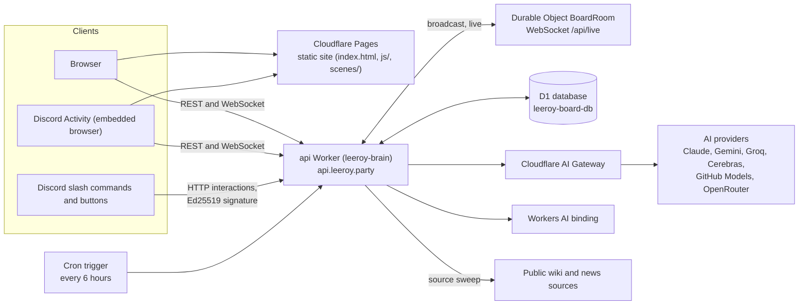

# Dungeons and Drinking: The Living Board (`leeroy-board`)

## What it is

The Living Board is a small web app that a five-player World of Warcraft group uses to plan their nights: a shared party sheet, sign-ups, a library of game notes, and "Leeroy", an AI assistant that answers questions from that library. It runs in a browser at https://leeroy.party and as a Discord Activity, and Discord slash commands talk to the same back end over HTTP. Everything runs on the Cloudflare free tier: static files on Pages, one Worker with a Durable Object for live updates, and a D1 (SQLite) database; there is no server to maintain and no separate bot process.

## Architecture

- Frontend: `index.html`, `js/`, `scenes/`, `css/`, `atlas/`, `room/` (plain browser JavaScript, no build step). [`js/brain.js`](js/brain.js) is the client for the Worker API.
- Back end: [`infrastructure/worker/index.js`](infrastructure/worker/index.js) is the single Worker entry point (REST routes, Discord interactions, cron handler). [`infrastructure/worker/room.js`](infrastructure/worker/room.js) is the `BoardRoom` Durable Object that fans out live events.
- AI: [`infrastructure/worker/ai-models.js`](infrastructure/worker/ai-models.js) picks a provider and routes calls through AI Gateway only when both `AI_GATEWAY_ID` and `CLOUDFLARE_ACCOUNT_ID` are non-empty in the Worker environment (`wrangler.toml` ships the account id empty; whether CI fills it in at deploy time is not verified here). Workers AI is used through the `AI` binding.
- Cron: [`infrastructure/worker/scraper.js`](infrastructure/worker/scraper.js) runs `0 */6 * * *`, snapshots the tracked sources into D1 and proposes wiki updates.

Routes, D1 config keys, secrets and local development are in [`infrastructure/README.md`](infrastructure/README.md).

## Environments

| Environment | Site | API |
| :--- | :--- | :--- |
| Production | https://leeroy.party (also www) | https://api.leeroy.party |
| Per-PR preview | `https://pr-<N>.leeroy-board.pages.dev` | `https://leeroy-brain-pr-<N>.<account-subdomain>.workers.dev` |

- Merging to `master` deploys production (`.github/workflows/deploy-cloudflare.yml`).
- Every pull request from a branch of this repository gets its own preview: a Pages deployment, a Worker named `leeroy-brain-pr-<N>`, and its own D1 database seeded from `data/`. The preview comment on the PR carries the URLs, and the preview is torn down when the PR is closed or merged.
- The Cloudflare account has 9 preview environments in total, shared by everyone, so keep to one open PR per contributor.
- Previews use Workers AI only (no provider keys are injected), have no cron trigger and no custom domain.
- Previews cannot test Discord: the Discord secrets are not set there and Discord posts only to production. Discord behaviour is checked on production after merge.

## Change process

Read [`CONTRIBUTING.md`](CONTRIBUTING.md). In short: one branch and one pull request per change, a risk rating in the PR, tests with back-end changes, and `node tools/stamps.mjs --write` after changing js, scenes or css.

## Tests and CI

The `Preview Tests` workflow (`.github/workflows/preview-tests.yml`) runs on every non-draft PR from this repository and posts one comment marked `<!-- preview-tests -->` with a result per suite for the head commit. No suite makes AI calls.

| Suite | What it checks | Run locally |
| :--- | :--- | :--- |
| Unit | Pure functions: budget maths, ids, name handling, persona loader, text formatting, stamp tool | `node --test "tests/unit/*.test.mjs"` |
| Stamps | Every `?v=` stamp equals the first 10 hex characters of the file's sha256 | `node tools/stamps.mjs --check` (fix with `--write`) |
| API | Against the preview Worker: health, bootstrap, state, CORS, refusal of unauthenticated writes, library, WebSocket, headers | `cd tests && npm ci && npm run test:api` |
| Browser | Playwright smoke checks in Chromium and WebKit, phone and desktop sizes, against the preview site | `cd tests && npm run test:browser -- --url "$PREVIEW_PAGES/"` |

Unit and Stamps need only Node 22 and run offline. API and Browser need the preview URLs and `BOARD_ADMIN_TOKEN` in the environment; see [`tests/README.md`](tests/README.md). Run with Node 22 or newer.

## Secrets and variables

Names and locations of secrets, including `KEY_SALT` and `USER_SALT` (Worker secrets), are listed in [`infrastructure/README.md`](infrastructure/README.md#secrets-and-variables). No secret value belongs in this repository.

## License

All rights reserved; see [`LICENSE.md`](LICENSE.md).
