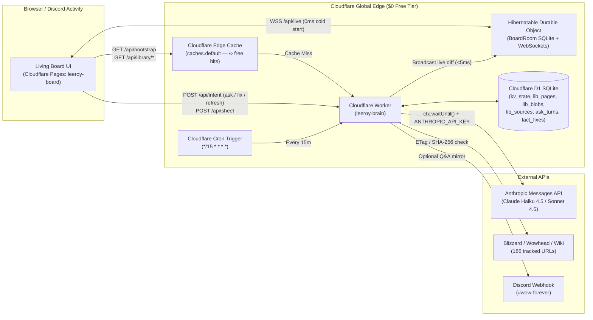

# Cloudflare 100% Serverless Infrastructure & GitHub Actions CI/CD Proposal

This directory (`infrastructure/`) contains the complete Infrastructure-as-Code (IaC), Cloudflare Worker runtime, D1 SQLite schema, automated seed tooling, and GitHub Actions CI/CD workflow to run the **Dungeons & Drinking Living Board** (`leeroy-board` + `leeroy-brain`) at **$0/month** on Cloudflare's Free Tier + the site's existing Anthropic Claude API key.

---

## 1. Architecture Overview (Zero VMs, Zero Git Data Commits)



### Cloudflare Free-Tier Quotas Used
| Resource | Cloudflare Free Quota | Board Usage |
| :--- | :--- | :--- |
| **Cloudflare Pages (`leeroy-board`)** | **Unlimited requests & bandwidth** | Hosts `index.html`, `js/`, `css/`, `scenes/`, `atlas/`, `img/`, `fonts/` |
| **Workers Requests (`leeroy-brain`)** | **100,000 req / day** | ~500–3,000 req/day (Edge Cache absorbs >95% of reads) |
| **Edge Cache (`caches.default`)** | **Unlimited (Unmetered)** | Serves `/api/bootstrap` and `/api/library/*.json` in 10–25 ms globally |
| **D1 Serverless SQLite** | **5 GB storage, 5M row reads/day, 100k writes/day** | ~3.5 MB total storage; 1-row reads per cache miss |
| **Durable Objects (`BoardRoom`)** | **100,000 req/day, 13,000 GB-s/day, 5 GB SQLite** | Hibernates at 0 GB-s when idle; instant `<5ms` WebSocket fan-out |
| **Cron Triggers** | **5 schedules / account** | 1 schedule (`*/15 * * * *` = 96 runs/day) |

---

## 2. Directory Contents

| File | Purpose |
| :--- | :--- |
| [`wrangler.toml`](./wrangler.toml) | Cloudflare Worker configuration (`leeroy-brain`), D1 binding (`DB`), SQLite Durable Object (`BoardRoom`), and `*/15 * * * *` Cron Trigger. |
| [`schema.sql`](./schema.sql) | Idempotent D1 SQLite schema (`kv_state`, `lib_pages`, `lib_blobs`, `lib_sources`, `ask_turns`, `fact_fixes`). |
| [`scripts/seed-d1.mjs`](./scripts/seed-d1.mjs) | Compiles existing `../data/*.json`, `../data/library/*.json`, and `../data/atlas/{links,marks}.json` into SQL batches and seeds D1 via `wrangler d1 execute`. |
| [`worker/index.js`](./worker/index.js) | Main Cloudflare Worker entry point (`/api/bootstrap`, `/api/library/:name`, `/api/data/:name`, `/api/atlas/:name`, `/api/intent`, `/api/sheet`, `/api/state`, `/api/live`). |
| [`worker/room.js`](./worker/room.js) | `BoardRoom` Hibernatable WebSocket Durable Object class (SQLite-backed live state & sub-5ms WebSocket broadcast). |
| [`worker/claude.js`](./worker/claude.js) | Direct Anthropic Messages API integration (`https://api.anthropic.com/v1/messages`) with D1 RAG context retrieval and live WebSocket + Discord webhook push. |
| [`worker/scraper.js`](./worker/scraper.js) | 15-minute Cron Trigger source sweep (`ETag` / `If-Modified-Since` / `SHA-256`) and D1 library blob rebuilder + Edge Cache invalidator. |
| [`workflows/deploy-cloudflare.yml`](./workflows/deploy-cloudflare.yml) | Reference copy of `.github/workflows/deploy-cloudflare.yml` for production deployment on new commits to `master`. |

---

## 3. Spinning Up & Deploying to Production via GitHub Actions (`master` Only)

The workflow at [`.github/workflows/deploy-cloudflare.yml`](../.github/workflows/deploy-cloudflare.yml) is configured to run **exclusively on new commits pushed to `master`**:

```yaml
on:
  push:
    branches:
      - master
```

Feature branches, pull requests, and non-`master` commits will **never** deploy to or mutate the production Cloudflare instance.

### Step 1: Create a Cloudflare API Token
1. Log into the [Cloudflare Dashboard](https://dash.cloudflare.com/) -> **My Profile** -> **API Tokens** -> **Create Token**.
2. Start from the **Edit Cloudflare Workers** template and ensure the following permissions are included:
   - **Account** -> **Workers Scripts**: `Edit`
   - **Account** -> **D1**: `Edit`
   - **Account** -> **Cloudflare Pages**: `Edit`
3. Copy your **API Token** and your **Account ID** (visible on the right sidebar of the Workers & Pages overview page).

### Step 2: Configure GitHub Repository Secrets
In your GitHub repository (`Matt-Bloise/leeroy-board`), navigate to **Settings -> Secrets and variables -> Actions -> New repository secret** and add:

| GitHub Secret Name | Required? | Description |
| :--- | :---: | :--- |
| `CLOUDFLARE_API_TOKEN` | **Yes** | Cloudflare API token with `Workers Scripts: Edit`, `D1: Edit`, and `Cloudflare Pages: Edit` permissions. |
| `CLOUDFLARE_ACCOUNT_ID` | **Yes** | Your 32-character Cloudflare Account ID. |
| `ANTHROPIC_API_KEY` | **Yes** | Site's Claude API key (`sk-ant-...`) used by `worker/claude.js` to answer `/ask` queries. |
| `BOARD_ADMIN_TOKEN` | Optional | Shared secret key matched against `#k=<token>` in the browser URL for write intents (`/api/intent`, `/api/sheet`). If omitted, writes are open to all party members. |
| `DISCORD_WEBHOOK_URL` | Optional | Discord channel webhook URL for `#wow-forever` to mirror Leeroy's Claude answers into Discord chat. |

### Step 3: Merge to `master`
When `feat/cloudflare-serverless-migration` (or any future commit) lands on `master`, GitHub Actions automatically executes the full production pipeline:

1. **D1 Provisioning (`Ensure D1 Database Exists`)**:
   - Checks if `leeroy-board-db` exists in your Cloudflare account. On the first `master` run, it creates `leeroy-board-db` (`npx wrangler d1 create leeroy-board-db`), extracts its UUID, and patches `database_id` in `infrastructure/wrangler.toml`.
2. **Schema Migration (`Apply Idempotent D1 Schema`)**:
   - Executes [`infrastructure/schema.sql`](./schema.sql) (`CREATE TABLE IF NOT EXISTS ...`) against the remote D1 database.
3. **Smart Initial Seeding (`Seed Initial Board & Library Data into D1`)**:
   - Checks `SELECT COUNT(*) FROM kv_state` in D1.
   - If the database is empty (`0` rows), runs [`scripts/seed-d1.mjs --remote`](./scripts/seed-d1.mjs) to populate all 9 board JSON documents, all 19 library blobs, all 59 library pages, and all 186 external source URLs.
   - On all subsequent `master` commits, it **skips seeding** so live edits, signups, and Claude Q&A turns stored in D1 are never overwritten by static repo files.
4. **Worker + Durable Object + Cron Deployment (`npx wrangler deploy`)**:
   - Deploys `leeroy-brain`, provisions the SQLite-backed `BoardRoom` Durable Object migration (`v1`), and activates the `*/15 * * * *` Cron Trigger.
5. **Secret Synchronization (`Sync Worker Secrets`)**:
   - Pushes `ANTHROPIC_API_KEY`, `BOARD_ADMIN_TOKEN`, and `DISCORD_WEBHOOK_URL` into encrypted Cloudflare Worker Secrets.
6. **Production Static Site Deployment (`Deploy to Cloudflare Pages Production`)**:
   - Stages the static frontend bundle (`index.html`, `atlas/`, `cloth/`, `css/`, `data/`, `fonts/`, `img/`, `js/`, `next/`, `room/`, `scenes/`, `vendor/`, `og-1200x630.jpg`, `robots.txt`), ensures the `leeroy-board` Cloudflare Pages project exists (`--production-branch=master`), and deploys the site directly to Cloudflare Pages production (`--branch=master`).

---

## 4. Local Development & Verification

You can run the entire Cloudflare Worker + D1 + Durable Objects stack locally on your machine using Wrangler's built-in Miniflare simulator without touching production:

```bash
cd infrastructure

# 1. Install Wrangler
npm install

# 2. Create local D1 SQLite tables
npm run d1:schema:local

# 3. Seed local D1 from ../data/*.json and ../data/library/*.json
npm run d1:seed:local

# 4. Start local Worker + Durable Object + Cron emulator on http://localhost:8787
npm run dev
```

To test the frontend against your local Worker, open the board with `?brain=http://localhost:8787/api` (or set `localStorage.setItem("board-brain-url", "http://localhost:8787/api")`).
