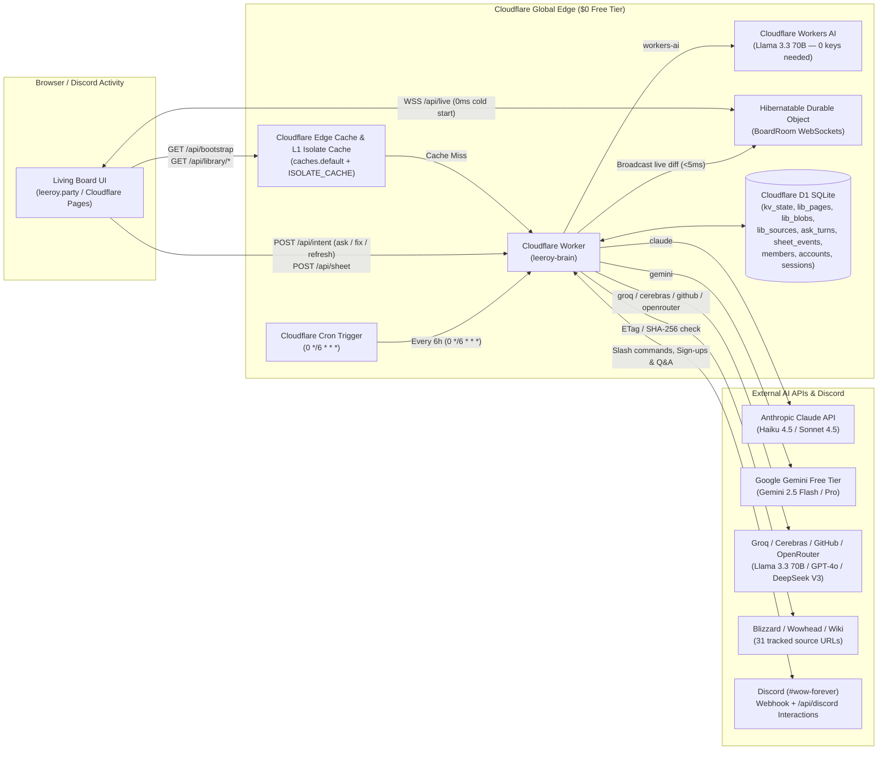
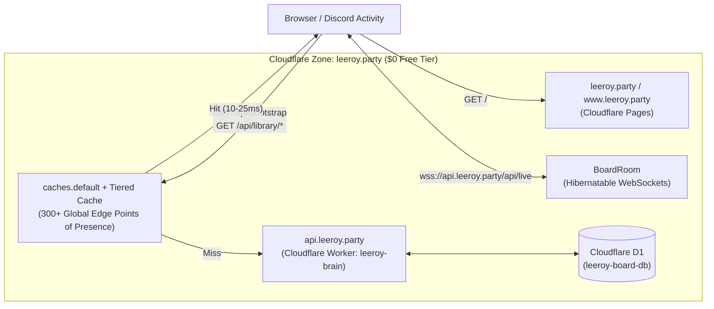

# Cloudflare 100% Serverless Infrastructure & GitHub Actions CI/CD Runbook

This directory (`infrastructure/`) contains the complete Infrastructure-as-Code (IaC), Cloudflare Worker runtime, D1 SQLite schema, and automated seed tooling to run the **Dungeons & Drinking Living Board** (`leeroy-board` + `leeroy-brain`) at **$0/month** on Cloudflare's Free Tier, with multi-provider AI support in [`worker/ai-models.js`](./worker/ai-models.js) for **Anthropic Claude**, **Google Gemini Free Tier**, **Cloudflare Workers AI Free Tier**, **Groq Free Tier**, **Cerebras Free Tier**, **GitHub Models Free Tier**, and **OpenRouter Free Tier**, paired with the live GitHub Actions workflows in [`.github/workflows/`](../.github/workflows/).

---

## 1. Architecture Overview (Zero VMs, Zero Git Data Commits)



### Cloudflare & AI Free-Tier Quotas Used
| Resource | Free Quota | Board Usage |
| :--- | :--- | :--- |
| **Cloudflare Pages (`leeroy-board`)** | **Unlimited requests & bandwidth** | Hosts `index.html`, `js/`, `css/`, `scenes/`, `atlas/`, `img/`, `fonts/` |
| **Workers Requests (`leeroy-brain`)** | **100,000 req / day** | ~500–3,000 req/day (Edge Cache absorbs >95% of reads) |
| **Edge Cache (`caches.default`)** | **Unlimited (Unmetered)** | Serves `/api/bootstrap` and `/api/library/*.json` in 10–25 ms globally |
| **D1 Serverless SQLite** | **5 GB storage, 5M row reads/day, 100k writes/day, 10 DBs** | ~3.5 MB total storage; 1 production DB + up to 9 concurrent PR preview DBs |
| **Durable Objects (`BoardRoom`)** | **100,000 req/day, 13,000 GB-s/day, 5 GB SQLite** | Hibernates at 0 GB-s when idle; native ping/pong; instant `<5ms` WebSocket fan-out (storage resides in D1) |
| **Cron Triggers** | **5 schedules / account** | 1 schedule (`0 */6 * * *` on production only, 4 runs/day keeping AI fact extraction strictly under the 10,000 Workers AI neuron/day free limit) |
| **Cloudflare Workers AI (`workers-ai`)** | **10,000 Neurons / day ($0, zero keys)** | Built-in `@cf/meta/llama-3.3-70b-instruct-fp8-fast` binding (`env.AI`) |
| **Google Gemini Free Tier (`gemini`)** | **15 RPM, 1,000,000 TPM, 1,500 req/day ($0)** | `gemini-2.5-flash` / `gemini-2.5-pro` via `GEMINI_API_KEY` |
| **Groq / Cerebras Free Tier (`groq` / `cerebras`)** | **1,000–14,400 req/day, 1M tokens/day ($0)** | Sub-400ms `llama-3.3-70b` via `GROQ_API_KEY` / `CEREBRAS_API_KEY` |
| **GitHub Models / OpenRouter (`github` / `openrouter`)** | **50–200 req/day ($0)** | OpenAI `gpt-4o-mini` / `gpt-4o` & `deepseek-chat-v3-0324:free` |

---

## 2. Directory & Workflow Contents

| File | Purpose |
| :--- | :--- |
| [`wrangler.toml`](./wrangler.toml) | Cloudflare Worker configuration (`leeroy-brain`), D1 binding (`DB`), Workers AI binding (`AI`), Durable Object (`BoardRoom`), `AI_PROVIDER` config, and `0 */6 * * *` Cron Trigger (6-hour autonomous source sweep). |
| [`schema.sql`](./schema.sql) | Idempotent baseline D1 SQLite schema (`kv_state`, `lib_pages`, `lib_blobs`, `lib_sources`, `lib_source_snapshots`, `wiki_proposals`, `ask_turns`, `fact_fixes`, `sheet_events`, `dispatches`, `members`, `sessions`, `user_state`) paired with incremental migrations in [`migrations/`](./migrations/). |
| [`migrations/`](./migrations/) | Numbered D1 SQL migrations (`0001_initial_schema.sql` through `0004_ask_turns_share.sql`) auto-applied in CI/CD via `wrangler d1 migrations apply`. |
| [`scripts/seed-d1.mjs`](./scripts/seed-d1.mjs) | Compiles 10 board JSON documents, 20 library blobs, 67 library pages, and 31 tracked source URLs into SQL batches and seeds D1 via `wrangler d1 execute`. |
| [`scripts/export-d1.mjs`](./scripts/export-d1.mjs) | Exports live D1 tables and precomputed TF-IDF library search indexes back to repository JSON files or triggers local rebuilds. |
| [`worker/index.js`](./worker/index.js) | Main Cloudflare Worker entry point (`/api/bootstrap`, `/api/library/:name`, `/api/data/:name`, `/api/atlas/:name`, `/api/intent`, `/api/ask`, `/api/signups`, `/api/discord`, `/api/sheet`, `/api/state`, `/api/live`) with L1 in-memory isolate caching and instant invalidation. |
| [`worker/room.js`](./worker/room.js) | `BoardRoom` Hibernatable WebSocket Durable Object class (stateless live pub/sub router with native `WebSocketRequestResponsePair` ping/pong to preserve hibernation, and sub-5ms broadcast). |
| [`worker/ai-models.js`](./worker/ai-models.js) | Multi-provider AI engine supporting **Claude**, **Gemini Free Tier**, **Cloudflare Workers AI**, **Groq**, **Cerebras**, **GitHub Models**, and **OpenRouter** with precomputed term vectors, compact prompt generation, and live WebSocket + Discord webhook push. |
| [`worker/discord.js`](./worker/discord.js) | Native Discord HTTP Interactions endpoint (`POST /api/discord` with Ed25519 signature verification) and external bot signup sync (`POST /api/signups`). |
| [`worker/scraper.js`](./worker/scraper.js) | 6-hour Cron Trigger source sweep (`0 */6 * * *`) with `ETag` / `If-Modified-Since` / `SHA-256` change detection, incremental vocabulary updates, and D1 library blob rebuilder. |
| [`.github/workflows/deploy-cloudflare.yml`](../.github/workflows/deploy-cloudflare.yml) | Live GitHub Actions workflow — deploys to **Production ONLY on new commits to `master`**. |
| [`.github/workflows/pr-preview-cloudflare.yml`](../.github/workflows/pr-preview-cloudflare.yml) | Live GitHub Actions workflow — spins up isolated **Ephemeral PR Environments** (`Pages + Worker + DO + D1`) on PR open/sync and tears them down on PR merge/close. |

---

## 3. Complete One-Time Setup Checklist (Required for Both PR & Production Environments)

Follow these **5 one-time steps** in order so both the **`master` Production Environment** and **Ephemeral PR Preview Environments** work out of the box.

### Step 1: Claim Your `*.workers.dev` Subdomain in Cloudflare (One-Time)
If your Cloudflare account has never deployed a Worker before, `wrangler deploy` requires a `*.workers.dev` subdomain to be registered once:
1. Log into the [Cloudflare Dashboard](https://dash.cloudflare.com/).
2. In the left sidebar, click **Workers & Pages -> Overview**.
3. Copy your **Account ID** from the right-hand sidebar (you will save this as `CLOUDFLARE_ACCOUNT_ID`).
4. Under **Subdomain** on the right-hand sidebar, click **Set up a subdomain** (or verify one is already active, e.g., `jmattbloise.workers.dev`).
   - *Note*: Both the production and PR GitHub Actions workflows automatically detect your account's `*.workers.dev` URL from `npx wrangler deploy` output and stamp it into the deployed static site's `js/brain.js`.

### Step 2: Create a Cloudflare API Token (`CLOUDFLARE_API_TOKEN`)
1. In the Cloudflare Dashboard, go to **My Profile (top-right avatar) -> API Tokens -> Create Token**.
2. Click **Use template** next to **Edit Cloudflare Workers**.
3. Under **Permissions**, ensure the token has these **5 permissions** (add D1, Workers AI, and Cloudflare Pages using **+ Add more**):
   - **Account** -> **Workers Scripts** -> `Edit` *(deploys & deletes production/PR Workers, Durable Objects, and Cron Triggers)*
   - **Account** -> **D1** -> `Edit` *(creates, migrates, seeds, and deletes production/PR D1 databases)*
   - **Account** -> **Cloudflare Pages** -> `Edit` *(creates the `leeroy-board` Pages project, deploys production & PR previews, and deletes closed PR preview deployments)*
   - **Account** -> **Workers AI** -> `Edit` or `Read` *(allows the `[ai]` binding to run `@cf/meta/llama-3.3-70b-instruct-fp8-fast` on Cloudflare's Free Tier)*
   - **Account** -> **Account Settings** -> `Read` *(allows Wrangler CLI to resolve account metadata in CI)*
4. Under **Account Resources**, select **Include -> All accounts** (or your specific account).
5. Click **Continue to summary -> Create Token**, and copy the token value.

### Step 3: Create AI API Key(s) (Configure Any Combination — or Use Built-in Workers AI with 0 Keys)

Because [`wrangler.toml`](./wrangler.toml#L25-L26) binds Cloudflare Workers AI (`[ai] binding = "AI"`), **`workers-ai` (Llama 3.3 70B) works immediately with zero external API keys**. You can also configure any or all of the following external providers:

#### A. Google Gemini Free Tier (`GEMINI_API_KEY` — $0, No Credit Card)
1. Sign into [Google AI Studio — API Keys (`https://aistudio.google.com/apikey`)](https://aistudio.google.com/apikey).
2. Click **Create API key** -> **Create API key in new project** (ensure the project has **no** Cloud Billing linked so it stays strictly on the **Free of charge** plan: 15 RPM, 1M TPM, 1,500 req/day on `gemini-2.5-flash`).
3. Copy the key (`AIzaSy...`) and save it as `GEMINI_API_KEY`.

#### B. GroqCloud Free Tier (`GROQ_API_KEY` — $0, Sub-400ms LPU Inference)
1. Sign into [GroqCloud Console (`https://console.groq.com/keys`)](https://console.groq.com/keys) (no credit card required).
2. Click **Create API Key**, copy the key (`gsk_...`), and save it as `GROQ_API_KEY` (1,000 req/day on `llama-3.3-70b-versatile`).

#### C. Cerebras Free Tier (`CEREBRAS_API_KEY` — $0, 1M Free Tokens/Day)
1. Sign into [Cerebras Cloud (`https://cloud.cerebras.ai`)](https://cloud.cerebras.ai) (no credit card required).
2. Go to **API Keys -> Create API Key**, copy the key (`csk-...`), and save it as `CEREBRAS_API_KEY` (1,000,000 tokens/day on `llama-3.3-70b`).

#### D. GitHub Models Free Tier (`GITHUB_MODELS_TOKEN` — $0, OpenAI GPT-4o / GPT-4o-mini)
1. In GitHub, go to **Settings -> Developer settings -> Personal access tokens -> Fine-grained tokens -> Generate new token**.
2. Under **Account permissions**, set **Models** to **Read-only** (`models: read`).
3. Copy the token (`github_pat_...`) and save it as `GITHUB_MODELS_TOKEN` (150 req/day on `gpt-4o-mini`, 50 req/day on `gpt-4o`).

#### E. OpenRouter Free Tier (`OPENROUTER_API_KEY` — $0, DeepSeek V3 `:free`)
1. Sign into [OpenRouter Keys (`https://openrouter.ai/keys`)](https://openrouter.ai/keys) (no credit card required for `:free` models).
2. Click **Create Key**, copy the key (`sk-or-v1-...`), and save it as `OPENROUTER_API_KEY` (uses `deepseek/deepseek-chat-v3-0324:free`).

#### F. Anthropic Claude (`ANTHROPIC_API_KEY`)
1. Sign into the [Anthropic Console (`https://console.anthropic.com/settings/keys`)](https://console.anthropic.com/settings/keys).
2. Copy your API key (`sk-ant-...`) and save it as `ANTHROPIC_API_KEY`.

### Step 4: Generate a Party Write Key (`BOARD_ADMIN_TOKEN`)
The frontend ([`js/brain.js`](../js/brain.js#L4)) validates that the write key (`#k=<token>`) matches `/^[A-Za-z0-9_-]{22,64}$/` (22 to 64 URL-safe characters).
1. Generate a valid 32-character token in your terminal:
   ```bash
   node -e "console.log(require('crypto').randomBytes(24).toString('base64url'))"
   ```
2. Save this token as `BOARD_ADMIN_TOKEN` in GitHub Secrets (Step 5).
3. **How Party Members Unlock Write Mode on the Board**:
   - Anyone opening `https://leeroy-board.pages.dev` (or a PR preview `https://pr-<N>.leeroy-board.pages.dev`) can browse the entire board, library, and live WebSocket updates **without** a key.
   - To unlock write actions (**Ask Leeroy**, **Fact Fixes**, **Sign-ups**, and **Character Sheet edits**), open the board once with `#k=<YOUR_BOARD_ADMIN_TOKEN>` appended to the URL:
     ```text
     https://leeroy.party/#k=<YOUR_BOARD_ADMIN_TOKEN>
     ```
   - `js/brain.js` automatically saves the key into `localStorage["board-key"]` and strips `#k=` from the address bar so the browser remembers you on all future visits.

### Step 5: Configure GitHub Repository Secrets & Actions Permissions
1. In your GitHub repository (`Matt-Bloise/leeroy-board`), go to **Settings -> Secrets and variables -> Actions -> New repository secret** and add:

| GitHub Secret Name | Required? | Used By | Description |
| :--- | :---: | :---: | :--- |
| `CLOUDFLARE_API_TOKEN` | **Yes** | Prod & PR | Cloudflare API token from Step 2 (`Workers Scripts: Edit`, `D1: Edit`, `Cloudflare Pages: Edit`, `Workers AI: Edit`, `Account Settings: Read`). |
| `CLOUDFLARE_ACCOUNT_ID` | **Yes** | Prod & PR | Your 32-character Cloudflare Account ID from Step 1. |
| `BOARD_ADMIN_TOKEN` | Recommended | Prod & PR | 22–64 char URL-safe token from Step 4 matched against `#k=<token>` in the browser or `Authorization: Bearer <token>` from the bot. |
| `ANTHROPIC_API_KEY` | Optional* | Prod only | Site's Claude API key (`sk-ant-...` from Step 3F) for `provider = "claude"` (omitted from PR previews). |
| `GEMINI_API_KEY` | Optional* | Prod only | Google AI Studio Free-Tier API key (`AIzaSy...` from Step 3A) for `provider = "gemini"` (omitted from PR previews). |
| `GROQ_API_KEY` | Optional* | Prod only | GroqCloud Free-Tier API key (`gsk_...` from Step 3B) for `provider = "groq"` (omitted from PR previews). |
| `CEREBRAS_API_KEY` | Optional* | Prod only | Cerebras Free-Tier API key (`csk-...` from Step 3C) for `provider = "cerebras"` (omitted from PR previews). |
| `GITHUB_MODELS_TOKEN` | Optional* | Prod only | GitHub PAT with `models: read` (Step 3D) for `provider = "github"` (GPT-4o / GPT-4o-mini, omitted from PR previews). |
| `OPENROUTER_API_KEY` | Optional* | Prod only | OpenRouter Free-Tier API key (`sk-or-...` from Step 3E) for `provider = "openrouter"` (DeepSeek V3 `:free`, omitted from PR previews). |
| `DISCORD_WEBHOOK_URL` | Optional | Prod only | Discord channel webhook URL for `#wow-forever` to mirror Leeroy's answers into Discord chat (excluded from PR previews). |
| `DISCORD_PUBLIC_KEY` | Optional | Prod only | Public key from the Discord Developer Portal if using `POST /api/discord` as a serverless Discord Interactions Endpoint. |

*\*Note: Even if zero external AI API key secrets are added, `workers-ai` (`@cf/meta/llama-3.3-70b-instruct-fp8-fast`) works automatically via Cloudflare's built-in `[ai]` binding.*

2. **Enable GitHub Actions PR Comment Permissions (Required for PR Previews)**:
   - In your GitHub repository, go to **Settings -> Actions -> General**.
   - Scroll down to **Workflow permissions**, select **Read and write permissions**, and click **Save**. *(This allows `.github/workflows/pr-preview-cloudflare.yml` to post and update the sticky PR comment containing your live preview URLs.)*
   - **Note on Fork PRs**: Pull requests opened from forks do not spin up PR preview environments (preventing secret exfiltration and resource consumption) and cannot be merged directly into `master`. Fork PRs must target a non-master branch (e.g. an integration or feature branch).

---

## 4. Operating the `master` Production Environment

The production workflow ([`.github/workflows/deploy-cloudflare.yml`](../.github/workflows/deploy-cloudflare.yml)) runs **exclusively on new commits pushed or merged to `master`**:

```yaml
on:
  push:
    branches:
      - master
```

### What Happens Automatically on Every `master` Push
1. **D1 Database Provisioning (`leeroy-board-db`)**: Checks if `leeroy-board-db` exists in your Cloudflare account; creates it on the first run and patches its UUID into `infrastructure/wrangler.toml`.
2. **Idempotent Schema & Numbered Migrations**: Runs [`infrastructure/schema.sql`](./schema.sql) (`CREATE TABLE IF NOT EXISTS ...`) followed by `npx wrangler d1 migrations apply leeroy-board-db --remote` (applying all pending migrations in `infrastructure/migrations/`).
3. **One-Time Initial Seeding**: Checks `SELECT COUNT(*) FROM kv_state`. If `0` (first deploy), runs [`scripts/seed-d1.mjs --remote`](./scripts/seed-d1.mjs) to load all 10 board JSON documents, 20 library blobs, 67 library pages, and 31 source URLs into D1. On all subsequent `master` commits, seeding is skipped so live party data in D1 is never overwritten.
4. **Worker + Durable Object + Cron Deployment**: Deploys `leeroy-brain`, provisions the `BoardRoom` Durable Object (`v1`), activates the `0 */6 * * *` Cron Trigger, and syncs all configured Worker secrets.
5. **Cloudflare Pages Production Deployment**: Stamps the production Worker URL into `.cloudflare-dist/js/brain.js`, creates the `leeroy-board` Cloudflare Pages project (`--production-branch=master`) if needed, and deploys the static site to `https://leeroy-board.pages.dev`.

### Production Verification Checklist (After First `master` Merge)
1. **Verify Worker & AI Providers Health**:
   ```bash
   curl -s https://api.leeroy.party/api/health
   ```
   Expected response (shows which AI providers are active):
   ```json
   {
     "ok": true,
     "service": "leeroy-brain",
     "runtime": "cloudflare-workers-d1",
     "aiProvider": "claude",
     "providers": {
       "claude": true,
       "gemini": true,
       "workers-ai": true,
       "groq": true,
       "cerebras": false,
       "github": true,
       "openrouter": true
     }
   }
   ```
2. **Verify D1 Bootstrap & Library Blobs**:
   - Open `https://leeroy-brain.<YOUR_SUBDOMAIN>.workers.dev/api/bootstrap` (returns `party`, `timeline`, `stats`, `signups`, `tonight`, `launch`, `marks`, `decide`).
   - Open `https://leeroy-brain.<YOUR_SUBDOMAIN>.workers.dev/api/library/index.json` (returns the 67-page library index).
3. **Verify Production Site & Write Key**:
   - Open `https://leeroy-board.pages.dev/#k=<YOUR_BOARD_ADMIN_TOKEN>` in your browser.
   - Open the **Leeroy** tab, pick any model from the dropdown, and send a test question.

---

## 5. Operating the Ephemeral PR Preview Environments

The PR preview workflow ([`.github/workflows/pr-preview-cloudflare.yml`](../.github/workflows/pr-preview-cloudflare.yml)) triggers on every Pull Request targeting `master` (`opened`, `synchronize`, `reopened`, `closed`):

| Layer | Production (`master`) | Ephemeral PR Preview (`PR #<N>`) |
| :--- | :--- | :--- |
| **Static Site (Pages)** | `https://leeroy-board.pages.dev` | `https://pr-<N>.leeroy-board.pages.dev` |
| **Worker + Durable Object** | `leeroy-brain` | `leeroy-brain-pr-<N>` |
| **D1 SQLite Database** | `leeroy-board-db` | `leeroy-board-db-pr-<N>` |
| **Cron Trigger** | Enabled (`0 */6 * * *`) | Stripped (preserves 5-cron Free-Tier account quota) |
| **Discord Webhook** | Enabled (`#wow-forever`) | Omitted (prevents PR test queries from spamming Discord) |
| **AI Model Provider** | Multi-Provider (Claude, Gemini, Groq, Cerebras, GitHub, OpenRouter, Workers AI) | **Cloudflare Workers AI ONLY** (zero external keys injected, locked to `@cf/meta/llama-3.3-70b-instruct-fp8-fast`) |

### PR Preview Lifecycle & Limits
1. **When a PR is Opened or Updated**:
   - Creates an isolated D1 database `leeroy-board-db-pr-<N>`, applies `schema.sql`, and seeds it from the PR branch's `data/*.json`.
   - Deploys an isolated Worker `leeroy-brain-pr-<N>` + `BoardRoom` Durable Object with **zero external AI API keys injected**, hardcoded to free native Cloudflare Workers AI (`AI_PROVIDER = "workers-ai"`, `IS_PR_PREVIEW = "true"`), and syncs `BOARD_ADMIN_TOKEN`.
   - Deploys the static site to `https://pr-<N>.leeroy-board.pages.dev` (pre-wired to `leeroy-brain-pr-<N>`) and posts a sticky comment on the PR with clickable links.
   - To test write actions on the PR preview, append your write key once: `https://pr-<N>.leeroy-board.pages.dev/#k=<YOUR_BOARD_ADMIN_TOKEN>`.
2. **When the PR is Merged or Closed**:
   - Automatically deletes `leeroy-brain-pr-<N>` (Worker + Durable Object), deletes `leeroy-board-db-pr-<N>` (D1 database), deletes the Cloudflare Pages preview deployments for branch `pr-<N>`, and updates the sticky PR comment to `🧹 Cloudflare Ephemeral PR Preview Torn Down`.
3. **Free-Tier Concurrency Limit**:
   - Cloudflare's Free Tier allows up to **10 D1 databases per account** (1 production DB + up to **9 simultaneously open PRs**). Merging or closing a PR immediately frees its D1 slot.

---

## 6. Switching Between AI Models

You can switch Leeroy's AI model across all **7 supported providers** (`claude`, `gemini`, `workers-ai`, `groq`, `cerebras`, `github`, `openrouter`) in three ways:
1. **Per-Question in the Web Board UI ([`js/ask.js`](../js/ask.js))**:
   - In the **Leeroy** tab (`#ask-form`), use the `#ask-model` dropdown. Your choice is saved in `localStorage["board-ai-provider"]` and sent with each question (`patch.provider`).
2. **Per-Command in Discord (`/ask`) or API**:
   - Pass `model: gemini` / `workers-ai` / `groq` / `cerebras` / `github` / `openrouter` / `claude` on `/ask`, or in JSON API calls: `POST /api/intent {"kind":"ask","q":"...","provider":"groq"}`.
3. **Global Default (`AI_PROVIDER` in [`wrangler.toml`](./wrangler.toml#L31))**:
   - Set `AI_PROVIDER` in `infrastructure/wrangler.toml`.
   - If the requested provider's API key is not configured, [`resolveAiProvider()`](./worker/ai-models.js#L43-L59) automatically falls back to the first configured provider (ending with built-in `workers-ai`, which requires no external key).

> [!IMPORTANT]
> **PR Preview Environments Use Zero AI Keys**: In ephemeral PR preview environments (where `IS_PR_PREVIEW = "true"`), all external AI keys are completely excluded from deployment. The Worker is locked to free native Cloudflare Workers AI (`@cf/meta/llama-3.3-70b-instruct-fp8-fast`), and the frontend board UI disables external models in the dropdown.

---

## 7. Hooking Up the Discord Bot & Discord Activity (`1561857940174938114`)

There are **three** touchpoints between Discord (`#wow-forever`) and the new Cloudflare deployment:

### A. Discord Embedded App / Activity URL Mappings
In [`index.html`](../index.html#L306), the board uses Discord Application ID `1561857940174938114`. When opened inside a Discord Voice channel Activity (`1561857940174938114.discordsays.com`), [`js/brain.js`](../js/brain.js#L55) routes API requests to `/api` and WebSockets to `wss://1561857940174938114.discordsays.com/api/live`.

To point the Discord Activity at your new Cloudflare deployment:
1. Open the [Discord Developer Portal](https://discord.com/developers/applications/1561857940174938114) -> select your application (`1561857940174938114`).
2. In the left sidebar under **Activities**, click **URL Mappings** and configure:

| Prefix | Target | Purpose |
| :--- | :--- | :--- |
| `/` | `leeroy.party` (or `leeroy-board.pages.dev`) | Serves the static board UI from Cloudflare Pages inside the Discord Activity iframe |
| `/api` | `api.leeroy.party/api` | Proxies all `/api/*` REST calls and `wss://.../api/live` WebSockets directly to the Cloudflare Worker |

### B. Outbound Answers to `#wow-forever` (`DISCORD_WEBHOOK_URL`)
Whenever someone asks Leeroy a question from the web board (`POST /api/intent { kind: "ask" }`), [`worker/ai-models.js`](./worker/ai-models.js#L353-L364) automatically posts the question and cited answer to `#wow-forever` if `DISCORD_WEBHOOK_URL` is set:
1. In Discord, open **Channel Settings (⚙️) for `#wow-forever` -> Integrations -> Webhooks -> New Webhook**.
2. Name it `Leeroy`, copy the **Webhook URL**, and save it as the `DISCORD_WEBHOOK_URL` secret in GitHub Actions.

### C. Connecting the Discord Bot (`Leeroy` Slash Commands & Sign-up Card Buttons)
You can connect the Discord bot in **either** of two ways:

#### Option 1: 100% Serverless Discord Bot (Zero Bot VM Needed)
The Cloudflare Worker includes a native Discord HTTP Interactions endpoint in [`worker/discord.js`](./worker/discord.js) (`POST /api/discord`):
1. In the [Discord Developer Portal](https://discord.com/developers/applications/1561857940174938114) -> **General Information**, copy the **Public Key** and add it as the `DISCORD_PUBLIC_KEY` secret in GitHub Actions.
2. On the same **General Information** page, set **Interactions Endpoint URL** to:
   ```text
   https://api.leeroy.party/api/discord
   # (or fallback: https://api.leeroy.party/api/discord)
   ```
   *(Discord will immediately send a signed `PING` request; the Worker verifies the `X-Signature-Ed25519` header using WebCrypto and responds with `PONG`.)*
3. What `POST /api/discord` handles automatically:
   - **`/ask <question> [model:claude|gemini|workers-ai|groq|cerebras|github|openrouter]` slash command**: Returns a deferred thinking state (`type: 5`) in `<5ms`, runs [`answerWithAi()`](./worker/ai-models.js) via `ctx.waitUntil()`, PATCHes the Discord message with Leeroy's cited answer, saves the turn in D1, and broadcasts it live to all open boards.
   - **Sign-ups Card Buttons (`signup:<field>:<value>`, e.g. `signup:rsvp:in`, `signup:pack:yes`, `signup:meet:Valley of Strength`, `signup:when:6pm`)**: Updates the caller's entry in D1 `kv_state['signups']`, recomputes all tallies, purges the Edge Cache, and broadcasts `{ type: "data", key: "signups" }` over WebSockets so the tavern table on the web board updates in `<5ms`.

#### Option 2: Keeping an Existing Gateway Discord Bot Process
If you already run a gateway bot script that listens to message events or reactions in `#wow-forever`, point its HTTP calls at the Worker instead of writing/committing JSON files to Git:
- **Board Link in Bot Replies**: `https://leeroy.party`
- **Forwarding `/ask` from Bot to Worker**:
  ```bash
  curl -X POST https://api.leeroy.party/api/intent \
    -H "Authorization: Bearer $BOARD_ADMIN_TOKEN" \
    -H "Content-Type: application/json" \
    -d '{"kind":"ask","by":"Mend","q":"When do dungeons unlock?","provider":"groq"}'
  ```
- **Syncing `#wow-forever` Sign-up Card Tallies to Worker**:
  ```bash
  curl -X POST https://api.leeroy.party/api/signups \
    -H "Authorization: Bearer $BOARD_ADMIN_TOKEN" \
    -H "Content-Type: application/json" \
    -d '{"name":"Mend","rsvp":"in","pack":"yes","meet":"Valley of Strength","when":"6pm"}'
  ```
- **Syncing Character Sheet Changes to Worker**:
  ```bash
  curl -X POST https://api.leeroy.party/api/sheet \
    -H "Authorization: Bearer $BOARD_ADMIN_TOKEN" \
    -H "Content-Type: application/json" \
    -d '{"member":"mend","patch":{"race":"undead","spec":"holy"}}'
  ```

---

## 8. Custom Domain & Edge Caching Architecture (`leeroy.party`)

Operating on the custom domain **`leeroy.party`** (managed natively in Cloudflare) unlocks Cloudflare's full **Global Edge Cache API (`caches.default`)** and **Tiered Cache** on the Free Tier ($0/month), reducing D1 database reads to near-zero and serving global requests in 10–25 ms.



### Why Operating on `leeroy.party` Maximizes Performance:
* **Unmetered Edge Cache Activation**: On default `*.workers.dev` subdomains, Cloudflare's programmatic Cache API (`caches.default`) is disabled by platform policy. Routing `leeroy-brain` through **`api.leeroy.party`** (a hostname inside an active Cloudflare Zone) activates Cloudflare's global edge cache across all 300+ data centers.
* **Tiered Cache**: Enables Cloudflare's regional data centers to act as reverse-proxy hubs, aggregating edge cache misses and shielding D1 from repetitive query load.
* **Unified CORS & Cookie Boundaries**: Both the frontend (`https://leeroy.party`) and API (`https://api.leeroy.party`) share the root domain, making CORS preflight checks minimal and eliminating cross-site tracker blocking issues in modern browsers and Discord Activity iframes.

---

### DNS & Hostname Routing Matrix (`leeroy.party`)

| Hostname | Target / Service | Managed By | Purpose |
| :--- | :--- | :--- | :--- |
| **`leeroy.party`** (Apex) | Cloudflare Pages (`leeroy-board`) | Pages Custom Domain | Primary web application frontend for party members |
| **`www.leeroy.party`** | Cloudflare Pages (`leeroy-board`) | Pages Custom Domain | Web alias redirecting or mirroring apex |
| **`api.leeroy.party`** | Cloudflare Worker (`leeroy-brain`) | Worker Custom Domain | Serverless API, Edge Cache, WebSockets, Discord bot interactions |

---

### Step-by-Step Custom Domain Activation

Because **`leeroy.party`** is already registered and managed by Cloudflare, DNS and SSL setup requires **zero external nameserver changes**:

#### Step 1: Bind `api.leeroy.party` to the Worker
The Worker's custom domain is pre-configured in [`infrastructure/wrangler.toml`](./wrangler.toml):
```toml
routes = [
  { pattern = "api.leeroy.party/*", custom_domain = true }
]
```
Running `npx wrangler deploy` automatically registers `api.leeroy.party` in your `leeroy.party` DNS zone, attaches the Worker route, and provisions a Cloudflare Universal SSL certificate.

*(Alternatively via Cloudflare Dashboard: Go to **Workers & Pages** -> **leeroy-brain** -> **Settings** -> **Domains & Routes** -> **Add** -> **Custom Domain** -> enter `api.leeroy.party` -> click **Add Custom Domain**).*

#### Step 2: Attach `leeroy.party` and `www.leeroy.party` to Cloudflare Pages
1. In the Cloudflare Dashboard, navigate to **Workers & Pages** -> **leeroy-board** (Pages project).
2. Go to **Custom domains** tab -> click **Set up a custom domain**.
3. Enter **`leeroy.party`** and click **Continue** -> **Activate domain**.
   *(Cloudflare automatically configures the apex CNAME flattening record in your DNS).* 
4. Repeat for **`www.leeroy.party`**.

#### Step 3: Enable Tiered Cache (100% Free)
1. In the Cloudflare Dashboard, select the **`leeroy.party`** zone.
2. In the left navigation, go to **Caching** -> **Tiered Cache**.
3. Toggle **Tiered Cache** to **Enabled**.
4. **Result**: Cache misses at an edge data center check regional Cloudflare Tiered Cache hubs before hitting D1, maintaining >95% cache hit rates globally.

#### Step 4: Verification & Edge Cache Confirmation
Run a test request against the API:
```bash
curl -I https://api.leeroy.party/api/bootstrap
```
Expected headers:
```http
HTTP/2 200
content-type: application/json; charset=utf-8
cf-cache-status: HIT
x-edge-cache: HIT
access-control-allow-origin: https://leeroy.party
```

---

## 9. Local Development & Verification

You can run the entire Cloudflare Worker + D1 + Durable Objects stack locally on your machine using Wrangler's built-in Miniflare simulator:

```bash
cd infrastructure

# 1. Install Wrangler and dependencies
npm install

# 2. Create local D1 SQLite tables & apply numbered migrations
npm run d1:schema:local
npm run d1:migrate:local

# 3. Seed local D1 from ../data/*.json, ../data/library/*.json, and ../data/atlas/
npm run d1:seed:local

# 4. Start local Worker + Durable Object + Cron emulator on http://localhost:8787
npm run dev
```

To test the frontend against your local Worker, open the board with `?brain=http://localhost:8787` (or `?brain=local`).


---

## 10. End-to-End Migration Guide (Cutting Over from Legacy Architecture)

This runbook guides you through a seamless, zero-downtime cutover from the legacy architecture (e.g. static site mirror of `wow-mage`, local Node.js daemon scripts, or Git-commit bots) to the 100% serverless Cloudflare stack.

### Phase 1: Pre-Migration & Credentials Setup (10 Minutes)
1. **Cloudflare Account ID & Workers Subdomain**:
   - Verify your Cloudflare account has an active `*.workers.dev` subdomain under **Workers & Pages -> Overview** ([Step 1](#step-1-claim-your-workersdev-subdomain-in-cloudflare-one-time)).
   - Note your 32-character Account ID.
2. **Generate Cloudflare API Token**:
   - Create a token with permissions for **Workers Scripts** (`Edit`), **D1** (`Edit`), **Cloudflare Pages** (`Edit`), **Workers AI** (`Edit`), and **Account Settings** (`Read`) ([Step 2](#step-2-create-a-cloudflare-api-token-cloudflare_api_token)).
3. **Generate Admin Party Write Token**:
   - Run `node -e "console.log(require('crypto').randomBytes(24).toString('base64url'))"` ([Step 4](#step-4-generate-a-party-write-key-board_admin_token)).
4. **Configure GitHub Secrets**:
   - In GitHub repository **Settings -> Secrets and variables -> Actions**, add:
     - `CLOUDFLARE_API_TOKEN` (Required)
     - `CLOUDFLARE_ACCOUNT_ID` (Required)
     - `BOARD_ADMIN_TOKEN` (Recommended)
     - Optional AI keys: `ANTHROPIC_API_KEY`, `GEMINI_API_KEY`, `GROQ_API_KEY`, `CEREBRAS_API_KEY`, `GITHUB_MODELS_TOKEN`, `OPENROUTER_API_KEY`
     - Optional Discord secrets: `DISCORD_WEBHOOK_URL`, `DISCORD_PUBLIC_KEY`
5. **Ensure Workflow Permissions**:
   - In **Settings -> Actions -> General -> Workflow permissions**, select **Read and write permissions**.

### Phase 2: First-Time Automated Deployment to Production (5 Minutes)
1. **Merge Migration Branch into `master`**:
   - Open and merge the Pull Request containing the Cloudflare infrastructure into `master`.
2. **Watch GitHub Actions Deploy**:
   - Open the **Actions** tab in GitHub and inspect the `Deploy Living Board to Cloudflare` workflow.
   - The workflow will automatically:
     1. Provision the production D1 database (`leeroy-board-db`).
     2. Apply `schema.sql` and run all numbered migrations in `infrastructure/migrations/`.
     3. Seed the D1 database from `data/*.json` and `data/library/*.json` (10 KV documents, 20 blobs, 67 pages, 31 sources).
     4. Deploy the `leeroy-brain` Worker, `BoardRoom` Durable Object, and `0 */6 * * *` Cron Trigger.
     5. Build and publish the static site to Cloudflare Pages at `https://leeroy-board.pages.dev`.

### Phase 3: Verification & Sanity Checks
1. **API & AI Provider Health**:
   ```bash
   curl -s https://leeroy-brain.<YOUR_SUBDOMAIN>.workers.dev/api/health
   ```
   Verify `"ok": true` and that active AI providers are reported correctly.
2. **Bootstrap & Library Payloads**:
   ```bash
   curl -s https://api.leeroy.party/api/bootstrap | jq '.party != null'
   curl -s https://api.leeroy.party/api/library/index.json | jq '.pages | length'
   ```
   Verify the bootstrap returns party state and the library returns 67 indexed pages.
3. **Frontend & Write Key**:
   - Open `https://leeroy-board.pages.dev/#k=<YOUR_BOARD_ADMIN_TOKEN>`.
   - Verify that the green live connection indicator illuminates.
   - In the **Leeroy** chamber tab, submit a test question to verify that streaming / instant Q&A answers with source citations.
   - Test an RSVP or character sheet modification to verify sub-5ms WebSocket fan-out.

### Phase 4: Discord Cutover (5 Minutes)
1. **Update Discord Activity URL Mappings**:
   - In the [Discord Developer Portal](https://discord.com/developers/applications/1561857940174938114) -> **Activities** -> **URL Mappings**:
     - Route `/` to `leeroy.party`
     - Route `/api` to `api.leeroy.party/api`
2. **Update Interactions Endpoint (Serverless Bot)**:
   - If using the native serverless bot, set **Interactions Endpoint URL** to `https://leeroy-brain.<YOUR_SUBDOMAIN>.workers.dev/api/discord`.
3. **External Bot / Gateway Bot (Alternative)**:
   - If keeping an existing Node.js bot script, point its outbound requests to `https://leeroy-brain.<YOUR_SUBDOMAIN>.workers.dev/api/signups` and `/api/sheet`, passing `Authorization: Bearer <BOARD_ADMIN_TOKEN>`.

### Phase 5: Decommissioning Legacy Infrastructure
Once the production Cloudflare Pages site and Worker are active:
1. **Stop Git-Commit Daemons**: Terminate any background cron jobs, Node.js scripts, or GitHub Actions that committed JSON files to Git on a timer or after Discord messages. All state is now cleanly managed in D1 SQLite.
2. **Retire Legacy Host**: If running on GitHub Pages or an external VM, update DNS records or deprecate the old URL.
3. **Backup / Export Anytime**: Run `npm run d1:export:remote` in `infrastructure/` whenever you want a local git-committable snapshot of the live D1 database.

### Phase 6: Custom Domain & Edge Caching Activation (`leeroy.party`)
Since **`leeroy.party`** is managed in Cloudflare:
1. **Worker API**: Deploying with `routes = [{ pattern = "api.leeroy.party/*", custom_domain = true }]` in `wrangler.toml` binds `api.leeroy.party` directly to `leeroy-brain` with automatic edge SSL.
2. **Pages Frontend**: In Cloudflare Dashboard -> **Workers & Pages** -> **leeroy-board** -> **Custom domains**, add `leeroy.party` and `www.leeroy.party`.
3. **Tiered Cache**: In **leeroy.party** Zone -> **Caching** -> **Tiered Cache**, toggle to **Enabled** to maximize edge cache hits.
