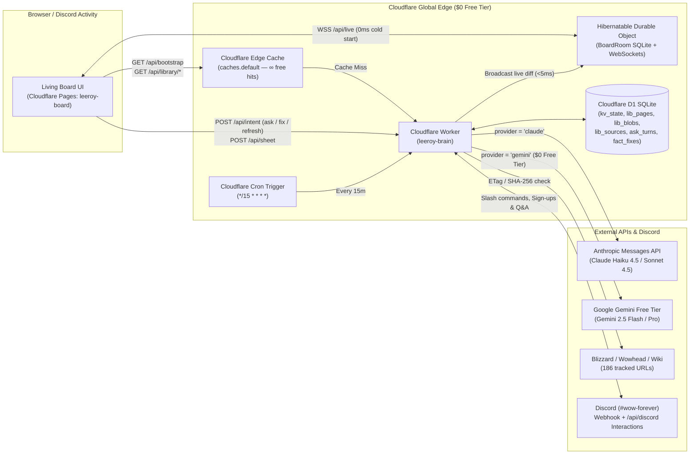

# Cloudflare 100% Serverless Infrastructure & GitHub Actions CI/CD Runbook

This directory (`infrastructure/`) contains the complete Infrastructure-as-Code (IaC), Cloudflare Worker runtime, D1 SQLite schema, and automated seed tooling to run the **Dungeons & Drinking Living Board** (`leeroy-board` + `leeroy-brain`) at **$0/month** on Cloudflare's Free Tier, with dual-provider AI support for both **Anthropic Claude** (`ANTHROPIC_API_KEY`) and **Google Gemini's Free Tier** (`GEMINI_API_KEY`), paired with the live GitHub Actions workflows in [`.github/workflows/`](../.github/workflows/).

---

## 1. Architecture Overview (Zero VMs, Zero Git Data Commits)



### Cloudflare & AI Free-Tier Quotas Used
| Resource | Free Quota | Board Usage |
| :--- | :--- | :--- |
| **Cloudflare Pages (`leeroy-board`)** | **Unlimited requests & bandwidth** | Hosts `index.html`, `js/`, `css/`, `scenes/`, `atlas/`, `img/`, `fonts/` |
| **Workers Requests (`leeroy-brain`)** | **100,000 req / day** | ~500–3,000 req/day (Edge Cache absorbs >95% of reads) |
| **Edge Cache (`caches.default`)** | **Unlimited (Unmetered)** | Serves `/api/bootstrap` and `/api/library/*.json` in 10–25 ms globally |
| **D1 Serverless SQLite** | **5 GB storage, 5M row reads/day, 100k writes/day, 10 DBs** | ~3.5 MB total storage; 1 production DB + up to 9 concurrent PR preview DBs |
| **Durable Objects (`BoardRoom`)** | **100,000 req/day, 13,000 GB-s/day, 5 GB SQLite** | Hibernates at 0 GB-s when idle; instant `<5ms` WebSocket fan-out |
| **Cron Triggers** | **5 schedules / account** | 1 schedule (`*/15 * * * *` on production only) |
| **Google Gemini Free Tier (`gemini-2.5-flash`)** | **15 RPM, 1,000,000 TPM, 1,500 req/day ($0)** | Selectable in UI, Discord `/ask`, or as default via `AI_PROVIDER = "gemini"` |

---

## 2. Directory & Workflow Contents

| File | Purpose |
| :--- | :--- |
| [`wrangler.toml`](./wrangler.toml) | Cloudflare Worker configuration (`leeroy-brain`), D1 binding (`DB`), SQLite Durable Object (`BoardRoom`), `AI_PROVIDER` config, and `*/15 * * * *` Cron Trigger. |
| [`schema.sql`](./schema.sql) | Idempotent D1 SQLite schema (`kv_state`, `lib_pages`, `lib_blobs`, `lib_sources`, `ask_turns`, `fact_fixes`). |
| [`scripts/seed-d1.mjs`](./scripts/seed-d1.mjs) | Compiles existing `../data/*.json`, `../data/library/*.json`, and `../data/atlas/{links,marks}.json` into SQL batches and seeds D1 via `wrangler d1 execute`. |
| [`worker/index.js`](./worker/index.js) | Main Cloudflare Worker entry point (`/api/bootstrap`, `/api/library/:name`, `/api/data/:name`, `/api/atlas/:name`, `/api/intent`, `/api/ask`, `/api/signups`, `/api/discord`, `/api/sheet`, `/api/state`, `/api/live`). |
| [`worker/room.js`](./worker/room.js) | `BoardRoom` Hibernatable WebSocket Durable Object class (SQLite-backed live state & sub-5ms WebSocket broadcast). |
| [`worker/claude.js`](./worker/claude.js) | Dual-provider AI integration supporting both **Anthropic Claude** (`ANTHROPIC_API_KEY`) and **Google Gemini Free Tier** (`GEMINI_API_KEY`) with D1 RAG context retrieval and live WebSocket + Discord webhook push. |
| [`worker/discord.js`](./worker/discord.js) | Native Discord HTTP Interactions endpoint (`POST /api/discord` with Ed25519 signature verification) and external bot signup sync (`POST /api/signups`). |
| [`worker/scraper.js`](./worker/scraper.js) | 15-minute Cron Trigger source sweep (`ETag` / `If-Modified-Since` / `SHA-256`) and D1 library blob rebuilder + Edge Cache invalidator. |
| [`.github/workflows/deploy-cloudflare.yml`](../.github/workflows/deploy-cloudflare.yml) | Live GitHub Actions workflow — deploys to **Production ONLY on new commits to `master`**. |
| [`.github/workflows/pr-preview-cloudflare.yml`](../.github/workflows/pr-preview-cloudflare.yml) | Live GitHub Actions workflow — spins up isolated **Ephemeral PR Environments** (`Pages + Worker + DO + D1`) on PR open/sync and tears them down on PR merge/close. |

---

## 3. Complete One-Time Setup Checklist (Required for Both PR & Production Environments)

Follow these **5 one-time steps** in order so both the **`master` Production Environment** and **Ephemeral PR Preview Environments** work out of the box.

### Step 1: Claim Your `*.workers.dev` Subdomain in Cloudflare (One-Time)
If your Cloudflare account has never deployed a Worker before, `wrangler deploy` requires a `*.workers.dev` subdomain to be registered once:
1. Log into the [Cloudflare Dashboard](https://dash.cloudflare.com/).
2. In the left sidebar, click **Workers & Pages -> Overview**.
3. Copy your **Account ID** from the right-hand sidebar (you will save this as `CLOUDFLARE_ACCOUNT_ID`).
4. Under **Subdomain** on the right-hand sidebar, click **Set up a subdomain** (or verify one is already active, e.g., `jmattbloise.workers.dev`).
   - *Note*: Both the production and PR GitHub Actions workflows automatically detect your account's `*.workers.dev` URL from `npx wrangler deploy` output and stamp it into the deployed static site's `js/brain.js`.

### Step 2: Create a Cloudflare API Token (`CLOUDFLARE_API_TOKEN`)
1. In the Cloudflare Dashboard, go to **My Profile (top-right avatar) -> API Tokens -> Create Token**.
2. Click **Use template** next to **Edit Cloudflare Workers**.
3. Under **Permissions**, ensure the token has these **4 permissions** (add D1 and Cloudflare Pages using **+ Add more**):
   - **Account** -> **Workers Scripts** -> `Edit` *(deploys & deletes production/PR Workers, Durable Objects, and Cron Triggers)*
   - **Account** -> **D1** -> `Edit` *(creates, migrates, seeds, and deletes production/PR D1 databases)*
   - **Account** -> **Cloudflare Pages** -> `Edit` *(creates the `leeroy-board` Pages project, deploys production & PR previews, and deletes closed PR preview deployments)*
   - **Account** -> **Account Settings** -> `Read` *(allows Wrangler CLI to resolve account metadata in CI)*
4. Under **Account Resources**, select **Include -> All accounts** (or your specific account).
5. Click **Continue to summary -> Create Token**, and copy the token value.

### Step 3: Create AI API Key(s) (`ANTHROPIC_API_KEY` and/or `GEMINI_API_KEY`)

#### Option A: Free-Tier Google Gemini API Key (`GEMINI_API_KEY` — $0 Cost)
Google AI Studio provides a **100% Free Tier** for `gemini-2.5-flash` (15 requests/minute, 1,000,000 tokens/minute, 1,500 requests/day) and `gemini-2.5-pro` with **no credit card or billing account required**:
1. Sign into [Google AI Studio — API Keys (`https://aistudio.google.com/apikey`)](https://aistudio.google.com/apikey) with your Google account.
2. Click **Create API key** in the top-right corner.
3. Choose **Create API key in new project** (or select an existing Google Cloud project that does **not** have Cloud Billing enabled so the key remains strictly locked to the **$0 Free Tier** and can never incur charges).
4. Confirm that the **Plan** column next to your new key says **Free of charge**.
5. Copy the generated key (starts with `AIzaSy...`).
6. *(Optional smoke test from your terminal)*:
   ```bash
   curl -s "https://generativelanguage.googleapis.com/v1beta/models/gemini-2.5-flash:generateContent?key=YOUR_GEMINI_API_KEY" \
     -H "Content-Type: application/json" \
     -d '{"contents":[{"parts":[{"text":"Say Leeroy Jenkins in one sentence."}]}]}'
   ```

#### Option B: Anthropic Claude API Key (`ANTHROPIC_API_KEY`)
1. Sign into the [Anthropic Console (`https://console.anthropic.com/settings/keys`)](https://console.anthropic.com/settings/keys).
2. Create or copy your existing API key (`sk-ant-...`).

### Step 4: Generate a Party Write Key (`BOARD_ADMIN_TOKEN`)
The frontend ([`js/brain.js`](../js/brain.js#L4)) validates that the write key (`#k=<token>`) matches `/^[A-Za-z0-9_-]{22,64}$/` (22 to 64 URL-safe characters).
1. Generate a valid 32-character token in your terminal:
   ```bash
   node -e "console.log(require('crypto').randomBytes(24).toString('base64url'))"
   ```
2. Save this token as `BOARD_ADMIN_TOKEN` in GitHub Secrets (Step 5).
3. **How Party Members Unlock Write Mode on the Board**:
   - Anyone opening `https://leeroy-board.pages.dev` (or a PR preview `https://pr-<N>.leeroy-board.pages.dev`) can browse the entire board, library, and live WebSocket updates **without** a key.
   - To unlock write actions (**Ask Leeroy**, **Fact Fixes**, **Sign-ups**, and **Character Sheet edits**), open the board once with `#k=<YOUR_BOARD_ADMIN_TOKEN>` appended to the URL:
     ```text
     https://leeroy-board.pages.dev/#k=<YOUR_BOARD_ADMIN_TOKEN>
     ```
   - `js/brain.js` automatically saves the key into `localStorage["board-key"]` and strips `#k=` from the address bar so the browser remembers you on all future visits.

### Step 5: Configure GitHub Repository Secrets & Actions Permissions
1. In your GitHub repository (`Matt-Bloise/leeroy-board`), go to **Settings -> Secrets and variables -> Actions -> New repository secret** and add:

| GitHub Secret Name | Required? | Used By | Description |
| :--- | :---: | :---: | :--- |
| `CLOUDFLARE_API_TOKEN` | **Yes** | Prod & PR | Cloudflare API token from Step 2 (`Workers Scripts: Edit`, `D1: Edit`, `Cloudflare Pages: Edit`, `Account Settings: Read`). |
| `CLOUDFLARE_ACCOUNT_ID` | **Yes** | Prod & PR | Your 32-character Cloudflare Account ID from Step 1. |
| `GEMINI_API_KEY` | One or Both | Prod & PR | Google AI Studio Free-Tier API key (`AIzaSy...` from Step 3A) used when `provider = "gemini"`. |
| `ANTHROPIC_API_KEY` | One or Both | Prod & PR | Site's Claude API key (`sk-ant-...` from Step 3B) used when `provider = "claude"`. |
| `BOARD_ADMIN_TOKEN` | Recommended | Prod & PR | 22–64 char URL-safe token from Step 4 matched against `#k=<token>` in the browser or `Authorization: Bearer <token>` from the bot. |
| `DISCORD_WEBHOOK_URL` | Optional | Prod only | Discord channel webhook URL for `#wow-forever` to mirror Leeroy's answers into Discord chat (excluded from PR previews). |
| `DISCORD_PUBLIC_KEY` | Optional | Prod only | Public key from the Discord Developer Portal if using `POST /api/discord` as a serverless Discord Interactions Endpoint. |

2. **Enable GitHub Actions PR Comment Permissions (Required for PR Previews)**:
   - In your GitHub repository, go to **Settings -> Actions -> General**.
   - Scroll down to **Workflow permissions**, select **Read and write permissions**, and click **Save**. *(This allows `.github/workflows/pr-preview-cloudflare.yml` to post and update the sticky PR comment containing your live preview URLs.)*
   - **Note on Fork PRs**: By default, GitHub does not pass repository `secrets.*` to `pull_request` workflows opened from an external fork. For PR preview environments to spin up automatically, either push feature branches directly to `Matt-Bloise/leeroy-board` (collaborator access) or enable **"Send write tokens to workflows from pull requests"** under **Settings -> Actions -> General -> Fork pull request workflows from outside collaborators**.

---

## 4. Operating the `master` Production Environment

The production workflow ([`.github/workflows/deploy-cloudflare.yml`](../.github/workflows/deploy-cloudflare.yml)) runs **exclusively on new commits pushed or merged to `master`**:

```yaml
on:
  push:
    branches:
      - master
```

### What Happens Automatically on Every `master` Push
1. **D1 Database Provisioning (`leeroy-board-db`)**: Checks if `leeroy-board-db` exists in your Cloudflare account; creates it on the first run and patches its UUID into `infrastructure/wrangler.toml`.
2. **Idempotent Schema Migration**: Runs [`infrastructure/schema.sql`](./schema.sql) (`CREATE TABLE IF NOT EXISTS ...`).
3. **One-Time Initial Seeding**: Checks `SELECT COUNT(*) FROM kv_state`. If `0` (first deploy), runs [`scripts/seed-d1.mjs --remote`](./scripts/seed-d1.mjs) to load all 9 board JSON documents, 19 library blobs, 59 library pages, and 186 source URLs into D1. On all subsequent `master` commits, seeding is skipped so live party data in D1 is never overwritten.
4. **Worker + Durable Object + Cron Deployment**: Deploys `leeroy-brain`, provisions the SQLite-backed `BoardRoom` Durable Object (`v1`), activates the `*/15 * * * *` Cron Trigger, and syncs all Worker secrets.
5. **Cloudflare Pages Production Deployment**: Stamps the production Worker URL into `.cloudflare-dist/js/brain.js`, creates the `leeroy-board` Cloudflare Pages project (`--production-branch=master`) if needed, and deploys the static site to `https://leeroy-board.pages.dev`.

### Production Verification Checklist (After First `master` Merge)
1. **Verify Worker & AI Health**:
   ```bash
   curl -s https://leeroy-brain.<YOUR_SUBDOMAIN>.workers.dev/api/health
   ```
   Expected response:
   ```json
   {"ok":true,"service":"leeroy-brain","runtime":"cloudflare-workers-d1","aiProvider":"claude","providers":{"claude":true,"gemini":true}}
   ```
2. **Verify D1 Bootstrap & Library Blobs**:
   - Open `https://leeroy-brain.<YOUR_SUBDOMAIN>.workers.dev/api/bootstrap` (returns `party`, `timeline`, `stats`, `signups`, `tonight`, `launch`, `marks`, `decide`).
   - Open `https://leeroy-brain.<YOUR_SUBDOMAIN>.workers.dev/api/library/index.json` (returns the 59-page library index).
3. **Verify Production Site & Write Key**:
   - Open `https://leeroy-board.pages.dev/#k=<YOUR_BOARD_ADMIN_TOKEN>` in your browser.
   - Open the **Leeroy** tab, select **Model: Claude (Anthropic)** or **Model: Gemini Free Tier**, and send a test question.

---

## 5. Operating the Ephemeral PR Preview Environments

The PR preview workflow ([`.github/workflows/pr-preview-cloudflare.yml`](../.github/workflows/pr-preview-cloudflare.yml)) triggers on every Pull Request targeting `master` (`opened`, `synchronize`, `reopened`, `closed`):

| Layer | Production (`master`) | Ephemeral PR Preview (`PR #<N>`) |
| :--- | :--- | :--- |
| **Static Site (Pages)** | `https://leeroy-board.pages.dev` | `https://pr-<N>.leeroy-board.pages.dev` |
| **Worker + Durable Object** | `leeroy-brain` | `leeroy-brain-pr-<N>` |
| **D1 SQLite Database** | `leeroy-board-db` | `leeroy-board-db-pr-<N>` |
| **Cron Trigger** | Enabled (`*/15 * * * *`) | Stripped (preserves 5-cron Free-Tier account quota) |
| **Discord Webhook** | Enabled (`#wow-forever`) | Omitted (prevents PR test queries from spamming Discord) |

### PR Preview Lifecycle & Limits
1. **When a PR is Opened or Updated**:
   - Creates an isolated D1 database `leeroy-board-db-pr-<N>`, applies `schema.sql`, and seeds it from the PR branch's `data/*.json`.
   - Deploys an isolated Worker `leeroy-brain-pr-<N>` + `BoardRoom` Durable Object and syncs `ANTHROPIC_API_KEY`, `GEMINI_API_KEY`, and `BOARD_ADMIN_TOKEN`.
   - Deploys the static site to `https://pr-<N>.leeroy-board.pages.dev` (pre-wired to `leeroy-brain-pr-<N>`) and posts a sticky comment on the PR with clickable links.
   - To test write actions on the PR preview, append your write key once: `https://pr-<N>.leeroy-board.pages.dev/#k=<YOUR_BOARD_ADMIN_TOKEN>`.
2. **When the PR is Merged or Closed**:
   - Automatically deletes `leeroy-brain-pr-<N>` (Worker + Durable Object), deletes `leeroy-board-db-pr-<N>` (D1 database), deletes the Cloudflare Pages preview deployments for branch `pr-<N>`, and updates the sticky PR comment to `🧹 Cloudflare Ephemeral PR Preview Torn Down`.
3. **Free-Tier Concurrency Limit**:
   - Cloudflare's Free Tier allows up to **10 D1 databases per account** (1 production DB + up to **9 simultaneously open PRs**). Merging or closing a PR immediately frees its D1 slot.

---

## 6. Switching Between Claude and Gemini's Free Tier

You can switch Leeroy's AI model between **Claude** and **Gemini Free Tier (`gemini-2.5-flash` / `gemini-2.5-pro`)** in three ways:
1. **Per-Question in the Web Board UI ([`js/ask.js`](../js/ask.js))**:
   - In the **Leeroy** tab (`#ask-form`), use the model dropdown (`Model: Claude (Anthropic)` vs `Model: Gemini Free Tier`). Your selection is saved in `localStorage["board-ai-provider"]` and sent with each question (`patch.provider`).
2. **Per-Command in Discord (`/ask`)**:
   - Pass `model: gemini` or `model: claude` on `/ask`, or in JSON API calls: `POST /api/intent {"kind":"ask","q":"...","provider":"gemini"}`.
3. **Global Default (`AI_PROVIDER` in [`wrangler.toml`](./wrangler.toml#L27))**:
   - Set `AI_PROVIDER = "gemini"` or `AI_PROVIDER = "claude"` in `infrastructure/wrangler.toml`.
   - Furthermore, [`resolveAiProvider()`](./worker/claude.js#L23-L30) automatically falls back to whichever provider has a configured API key secret if only `GEMINI_API_KEY` or only `ANTHROPIC_API_KEY` is present.

---

## 7. Hooking Up the Discord Bot & Discord Activity (`1561857940174938114`)

There are **three** touchpoints between Discord (`#wow-forever`) and the new Cloudflare deployment:

### A. Discord Embedded App / Activity URL Mappings
In [`index.html`](../index.html#L306), the board uses Discord Application ID `1561857940174938114`. When opened inside a Discord Voice channel Activity (`1561857940174938114.discordsays.com`), [`js/brain.js`](../js/brain.js#L55) routes API requests to `/api` and WebSockets to `wss://1561857940174938114.discordsays.com/api/live`.

To point the Discord Activity at your new Cloudflare deployment:
1. Open the [Discord Developer Portal](https://discord.com/developers/applications/1561857940174938114) -> select your application (`1561857940174938114`).
2. In the left sidebar under **Activities**, click **URL Mappings** and configure:

| Prefix | Target | Purpose |
| :--- | :--- | :--- |
| `/` | `leeroy-board.pages.dev` | Serves the static board UI from Cloudflare Pages inside the Discord Activity iframe |
| `/api` | `leeroy-brain.<YOUR_SUBDOMAIN>.workers.dev/api` | Proxies all `/api/*` REST calls and `wss://.../api/live` WebSockets directly to the Cloudflare Worker |

### B. Outbound Answers to `#wow-forever` (`DISCORD_WEBHOOK_URL`)
Whenever someone asks Leeroy a question from the web board (`POST /api/intent { kind: "ask" }`), [`worker/claude.js`](./worker/claude.js#L243-L253) automatically posts the question and Claude/Gemini's cited answer to `#wow-forever` if `DISCORD_WEBHOOK_URL` is set:
1. In Discord, open **Channel Settings (⚙️) for `#wow-forever` -> Integrations -> Webhooks -> New Webhook**.
2. Name it `Leeroy`, copy the **Webhook URL**, and save it as the `DISCORD_WEBHOOK_URL` secret in GitHub Actions.

### C. Connecting the Discord Bot (`Leeroy` Slash Commands & Sign-up Card Buttons)
You can connect the Discord bot in **either** of two ways:

#### Option 1: 100% Serverless Discord Bot (Zero Bot VM Needed)
The Cloudflare Worker includes a native Discord HTTP Interactions endpoint in [`worker/discord.js`](./worker/discord.js) (`POST /api/discord`):
1. In the [Discord Developer Portal](https://discord.com/developers/applications/1561857940174938114) -> **General Information**, copy the **Public Key** and add it as the `DISCORD_PUBLIC_KEY` secret in GitHub Actions.
2. On the same **General Information** page, set **Interactions Endpoint URL** to:
   ```text
   https://leeroy-brain.<YOUR_SUBDOMAIN>.workers.dev/api/discord
   ```
   *(Discord will immediately send a signed `PING` request; the Worker verifies the `X-Signature-Ed25519` header using WebCrypto and responds with `PONG`.)*
3. What `POST /api/discord` handles automatically:
   - **`/ask <question> [model:claude|gemini]` slash command**: Returns a deferred thinking state (`type: 5`) in `<5ms`, runs [`answerWithClaude()`](./worker/claude.js) (using Claude or Gemini Free Tier) via `ctx.waitUntil()`, PATCHes the Discord message with Leeroy's cited answer, saves the turn in D1, and broadcasts it live to all open boards.
   - **Sign-ups Card Buttons (`signup:<field>:<value>`, e.g. `signup:rsvp:in`, `signup:pack:yes`, `signup:meet:Valley of Strength`, `signup:when:6pm`)**: Updates the caller's entry in D1 `kv_state['signups']`, recomputes all tallies, purges the Edge Cache, and broadcasts `{ type: "data", key: "signups" }` over WebSockets so the tavern table on the web board updates in `<5ms`.

#### Option 2: Keeping an Existing Gateway Discord Bot Process
If you already run a gateway bot script that listens to message events or reactions in `#wow-forever`, point its HTTP calls at the Worker instead of writing/committing JSON files to Git:
- **Board Link in Bot Replies**: `https://leeroy-board.pages.dev`
- **Forwarding `/ask` from Bot to Worker (using Claude or Gemini Free Tier)**:
  ```bash
  curl -X POST https://leeroy-brain.<YOUR_SUBDOMAIN>.workers.dev/api/intent \
    -H "Authorization: Bearer $BOARD_ADMIN_TOKEN" \
    -H "Content-Type: application/json" \
    -d '{"kind":"ask","by":"Mend","q":"When do dungeons unlock?","provider":"gemini"}'
  ```
- **Syncing `#wow-forever` Sign-up Card Tallies to Worker**:
  ```bash
  curl -X POST https://leeroy-brain.<YOUR_SUBDOMAIN>.workers.dev/api/signups \
    -H "Authorization: Bearer $BOARD_ADMIN_TOKEN" \
    -H "Content-Type: application/json" \
    -d '{"name":"Mend","rsvp":"in","pack":"yes","meet":"Valley of Strength","when":"6pm"}'
  ```
- **Syncing Character Sheet Changes to Worker**:
  ```bash
  curl -X POST https://leeroy-brain.<YOUR_SUBDOMAIN>.workers.dev/api/sheet \
    -H "Authorization: Bearer $BOARD_ADMIN_TOKEN" \
    -H "Content-Type: application/json" \
    -d '{"member":"mend","patch":{"race":"undead","spec":"holy"}}'
  ```

---

## 8. Local Development & Verification

You can run the entire Cloudflare Worker + D1 + Durable Objects stack locally on your machine using Wrangler's built-in Miniflare simulator:

```bash
cd infrastructure

# 1. Install Wrangler
npm install

# 2. Create local D1 SQLite tables
npm run d1:schema:local

# 3. Seed local D1 from ../data/*.json and ../data/library/*.json
npm run d1:seed:local

# 4. Start local Worker + Durable Object + Cron emulator on http://localhost:8787
npm run dev
```

To test the frontend against your local Worker, open the board with `?brain=http://localhost:8787` (or `?brain=local`).
